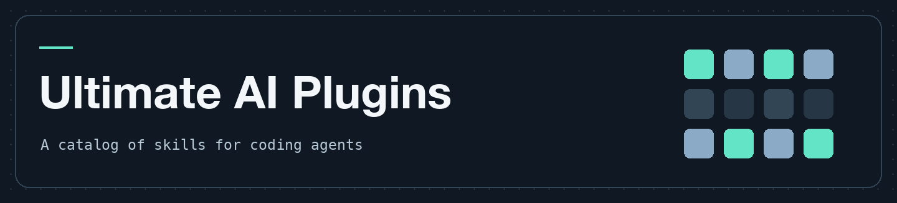

# Ultimate AI Plugins



A library of 28 plugins for AI coding agents. Use them to plan a feature, write and review code, build a design system, ship an Apple app, audit a site, document a repository, or produce launch materials.

The same source collection supports **Codex and ChatGPT desktop**, **Claude Code**, and **Kimi Code** through native catalogs. **OpenCode, Gemini CLI, and other Agent Skills hosts** can use the shared workflows from a local checkout. Individual jobs may require a shell, browser, SDK, MCP server, connected account, or a host that can delegate.

[Install](#install) · [Browse plugins](#plugin-catalog) · [Host guide](docs/hosts.md) · [Credits](docs/credits.md)

## Install

From a terminal, clone the collection and enter the checkout.

```sh
git clone https://github.com/andrewr303/ultimate-AI-plugins.git
cd ultimate-AI-plugins
```

Start with **Doc Atlas**. Select its `repo-docs` skill in a session opened on a project you want to document, then ask “Audit this repository’s README and suggest the smallest changes that would help a newcomer run it.” Expect findings tied to the project’s actual files and commands.

| Host | Install or discover plugins |
| --- | --- |
| **Codex CLI** | Run `codex plugin marketplace add "$PWD"`, then `codex plugin add doc-atlas@ultimate-ai-plugins`. Start a fresh session. |
| **ChatGPT desktop** | Open this checkout as a project, restart the app if needed, and choose **Ultimate AI Plugins** as the source in the Plugins Directory in Work or Codex. Install **Doc Atlas**. |
| **Claude Code** | Run `claude --plugin-dir ./plugins/documentation/doc-atlas` to try one plugin. For the full catalog, use `/plugin marketplace add` with this checkout’s absolute path. |
| **Kimi Code** | Run `/plugins marketplace <absolute-path-to-checkout>/kimi.marketplace.json` in Kimi Code. Alternatively, use `/plugins install` with the absolute plugin directory. Run `/reload` after installation. |
| **OpenCode, Gemini CLI, and other local Agent Skills hosts** | From this checkout run `python3 scripts/plugin_catalog.py register-skill doc-atlas --project /path/to/your-project`. Open a new session in that project and ask for `ucp-doc-atlas`. |

The shared skill registration requires Python 3.9 or later and keeps the checkout as the source of the workflow and supporting files. See the host guide for account and workspace requirements, ChatGPT web options, structured install steps, and feature differences. [Host installation guide](docs/hosts.md)

## Plugin catalog

Each plugin page includes a first prompt, the entry skill, and package-specific setup.

[Engineering](#engineering-and-delivery) · [Writing and docs](#documentation-and-writing) · [Apple](#apple-platforms) · [Design](#ui-and-design-systems) · [Motion](#motion-and-interaction) · [Quality](#security-accessibility-and-performance) · [Growth](#product-marketing-and-growth) · [Creative](#image-and-video-direction)

### Engineering and delivery

| Plugin | Start with | What it does |
| --- | --- | --- |
| [Ult Engineer](plugins/engineering/ult-engineer/README.md) | `ult-engineer` | Routes TypeScript, JavaScript, React, and Node.js work to writing, debugging, refactoring, review, testing, and repository-health specialists. The debugging workflows use runtime evidence such as a failing test, a DAP trace, or NDJSON logs. Some checks require separately installed tools. |
| [Ultimate SDD](plugins/engineering/ultimate-sdd/README.md) | `orchestrator` | Turns a project brief into a PRD, requirements, scoped tasks, and verification evidence under the target project’s `docs/plan/`. Its Python tools validate the artifact graph, govern lifecycle transitions, and support checkpoints and read-only rollback previews. Independent review steps require a separate reviewer. |
| [Issue Assistant](plugins/engineering/issue-assistant/README.md) | `issue-assistant` | Reconciles GitHub or Linear issues with code, PRs, and acceptance evidence. Preview a backlog review, investigate a named issue, or break it down into verifiable subtasks. Live tracker reads and writes require suitable connections and authorization. |

### Documentation and writing

| Plugin | Start with | What it does |
| --- | --- | --- |
| [Doc Atlas](plugins/documentation/doc-atlas/README.md) | `repo-docs` | Builds and audits READMEs, guides, documentation sites, API references, and diagrams using repository evidence. Includes read-only inventory and Markdown preflight helpers. A site’s build and rendering checks use its own stack. |
| [Ultimate Prose](plugins/documentation/ultimate-prose/README.md) | `ultimate-prose` | Edits emails, posts, essays, proposals, and updates using Andrew Rodriguez’s personal voice profile. Its Python checks surface wording and factual changes for review. Choose this edition when the requested voice is Andrew’s. |
| [Ultimate Prose Universal](plugins/documentation/ultimate-prose-universal/README.md) | `ultimate-prose-universal` | Drafts, revises, and reviews text in an explicitly chosen tone. Can calibrate to the author’s samples and includes lint, prose statistics, and factual-fidelity checks. The standalone release uses the upstream skill name `ultimate-prose`. |

### Apple platforms

| Plugin | Start with | What it does |
| --- | --- | --- |
| [Apple Compliance](plugins/apple/apple-compliance/README.md) | `apple-compliance` | Prepares evidence for App Store review and distribution, including privacy manifests and labels, signing and entitlements, TestFlight, store assets, and rejection follow-up. Use it to identify what your app still needs to verify before submission. |
| [Apple Swift, iOS & macOS](plugins/apple/apple-swift-ios-and-macos/README.md) | `apple-platform-router` | Handles Swift concurrency, SwiftUI refactoring, Liquid Glass adoption, Instruments profiling, simulator debugging, menu bar apps, and SwiftPM packaging. Xcode, Instruments, and simulator tasks need an appropriate macOS setup. |
| [iOS Backend Studio](plugins/apple/ios-backend-studio/README.md) | `ios-backend-studio` | Plans and verifies services behind iOS apps. Covers provider selection, auth, data and sync, webhooks, notifications, environments, observability, and rollout. Use its provider-specific guidance with the credentials and tools available in your host. |
| [iOS Development Studio](plugins/apple/ios-development-studio/README.md) | `ios-development` | Covers native iOS architecture, SwiftUI, UIKit, persistence, networking, concurrency, test evidence, App Store work, and selected React Native or Expo workflows. Local builds and simulator runs depend on the project’s Apple toolchain. |
| [Mac Developer](plugins/apple/mac-developer/README.md) | `mac-developer` | Plans and builds native Mac apps, adapts Node.js projects, and covers background services, browser companions, debugging, and distribution. It directs work through the existing product’s architecture and release constraints. |

### UI and design systems

| Plugin | Start with | What it does |
| --- | --- | --- |
| [Anti-Slop & Design Quality](plugins/design/anti-slop-and-design-quality/README.md) | `antislop` | Reviews generic-looking UI, copy, responsive layout, code comments, and contrast. Its specialist skills help turn observations into concrete edits, with a contrast checker for measured color work. |
| [Design Variations](plugins/design/design-variations/README.md) | `design-variations` | Explores directions in interactive rounds, usually ten variations per round, then iterates on selected options. Uses available design-reference tools and maintains a comparison record. Live canvas and browser evidence depend on the host. |
| [UI Component Expert](plugins/design/ui-component-expert/README.md) | `ui-component-expert` | Turns a manually downloaded Claude Design export into a typed design contract and a reviewed implementation worklist for React and TypeScript. It compares native HTML and headless primitives, quarantines raw exports, and requires separately observed browser evidence before claiming visual verification. Experimental. |
| [Web Design & UI Systems](plugins/design/web-design-and-ui-systems/README.md) | `web-design-router` | Routes page and design-system work across styles, palettes, type pairings, UI patterns, brand, pricing, landing pages, and slide design. Includes a searchable UI/UX reference database. Some demos are available as previews only. |

### Motion and interaction

| Plugin | Start with | What it does |
| --- | --- | --- |
| [Liquid Glass Studio](plugins/motion/liquid-glass-studio/README.md) | `liquid-glass-studio` | Designs and reviews glass interfaces from optics and rim lighting through motion, contrast, native APIs, and performance. Includes a reference engine and a lab for inspecting effects and fallbacks. |
| [Platform Motion Wizard](plugins/motion/platform-motion-wizard/README.md) | `platform-motion-wizard` | Designs feedback for controls, overlays, navigation, loading, and gestures across web and native apps. Includes an interaction lab and recipes for interrupting animations, dropping stale responses, and respecting reduced motion. |

### Security, accessibility and performance

| Plugin | Start with | What it does |
| --- | --- | --- |
| [DeepSec Agent](plugins/quality/deepsec-agent/README.md) | `deepsec-review` | Runs local defensive source review with a Node.js CLI, rules, baselines, and JSON, Markdown, or SARIF output. Bind its local MCP server to an authorized checkout before starting it. Findings are evidence for source review and remediation. |
| [Security Audit](plugins/quality/security-audit/README.md) | `security-audit` | Plans source and dependency audits, triages scanner results, compares reports against a baseline, and prepares remediation findings. Scanners are optional external dependencies. Inspect the plan and coverage before drawing conclusions. |
| [Ult Accessability](plugins/quality/ult-accessability/README.md) | `ult-accessability` | Routes WCAG 2.2 AA or AAA audit, contrast, testing, and remediation work. Combines automated results with manual interaction evidence when a live page is available. The spelling is the package ID used by installers. |
| [Ult Performance](plugins/quality/ult-performance/README.md) | `ult-performance` | Investigates loading, interaction, media, scroll, and Core Web Vitals. Includes DevTools snippets for lab measurement and guidance for distinguishing those results from field data. A live browser is needed for traces. |

### Product, marketing and growth

| Plugin | Start with | What it does |
| --- | --- | --- |
| [Creator Intelligence](plugins/product-and-growth/creator-intelligence/README.md) | `creator-research` | Discovers and vets creators using public content and public business contact data. Includes transparent scoring, comment and transcript analysis, competitor research, trend discovery, and optional ScrapeCreators workflows. |
| [Freelance Legend](plugins/product-and-growth/freelance-legend/README.md) | `freelance-legend` | Evaluates freelance leads, develops scoped proposals, and guides client communication and delivery. Its bundled portfolio evidence and operating preferences are tailored to Andrew Rodriguez. |
| [Marketing Page Studio](plugins/product-and-growth/marketing-page-studio/README.md) | `marketing-page-studio` | Builds marketing sites around product evidence, an audience and conversion story, and interactive demonstrations. Includes composition and scroll workflows plus steps for checking claims and browser behavior. |
| [Product Demo Studio](plugins/product-and-growth/product-demo-studio/README.md) | `product-demo-studio` | Produces product-demo scripts, storyboards, footage plans, captions, and social variants. Its Python tooling supports render and delivery receipts. Real capture and render work uses a browser and media tools such as FFmpeg. |
| [SEO GEO God](plugins/product-and-growth/seo-geo-god/README.md) | `seo-geo-god` | Audits and changes site implementation for crawlability, rendered metadata, canonical URLs, structured data, sitemaps, international targeting, and AI-crawler access. Its Python CLI supports offline checks and CI gates. |

### Image and video direction

| Plugin | Start with | What it does |
| --- | --- | --- |
| [Image Prompt Director](plugins/creative/image-prompt-director/README.md) | `image-prompts` | Writes five image prompts by default, with direction for composition, lighting, materials, exact text, and reference fidelity. Supports targeted edits and consistent series. Generate images in the chosen image model. |
| [Video Prompt Director](plugins/creative/video-prompt-director/README.md) | `video-prompts` | Writes five video concepts by default, with timed action, shots, camera direction, continuity, sound, and reference roles. Supports keyframes, loops, edits, and longer sequences. Render and assemble the clips in your chosen tools. |

## Companion tools

[Session Control Chrome](companion-tools/session-control-chrome/README.md) packages a Chrome extension and local bridge for working with agent sessions and browser profiles. Follow its own installation guide and use its [release ZIP](artifacts/session-control-chrome/session-control-chrome-0.5.0.zip) when you need the original download.

## Maintaining the collection

- [`plugins/`](plugins) contains editable source under eight categories. Plugin names are stable marketplace identifiers. Each package carries a portable manifest and the host manifests for its supported native entry points.
- [`artifacts/`](artifacts/README.md) holds original distributable ZIP and skill releases, including versions older than the editable sources. `dist/` holds the original Claude upload packages for the five existing plugins.
- Catalog entries are generated from plugin folders and manifests. After changing a package or moving it, run `python3 scripts/plugin_catalog.py sync` and `python3 scripts/plugin_catalog.py check`. Verify changes with the affected plugin’s own checks as well.

To rebuild a Claude upload archive, run `python3 scripts/pack_plugin.py plugins/engineering/ult-engineer dist` from the repository root. The packer checks manifest placement, archive paths, and shell script handling. Verify the runtime on the intended host separately.

See the [repository license](LICENSE) and the license or notices shipped with each plugin and its bundled assets. Some notices identify materials with unclear redistribution terms. The [credits](docs/credits.md) record the original collection’s upstream sources.
