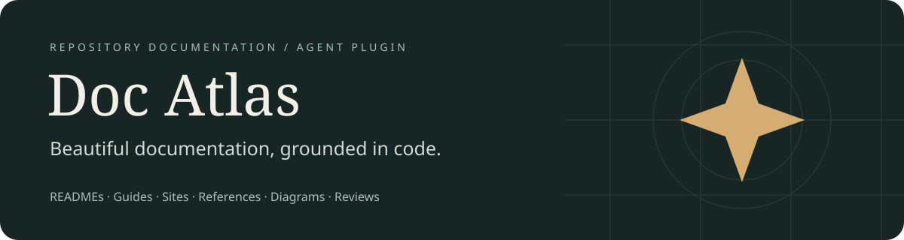
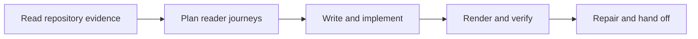

# Doc Atlas

An agent plugin for documentation that looks deliberate and stays connected to the code it describes. Turn README files, source, examples and API schemas into a coherent documentation experience.

**Start with a prompt:**

> Inspect this repository, then improve its README and documentation. Keep its existing stack, trace commands to the code, and verify the result.

## Try it

After installing from the [host guide](https://github.com/andrewr303/ultimate-AI-plugins/blob/main/docs/hosts.md), open your target project and select [`repo-docs`](skills/repo-docs/SKILL.md). Try this prompt.

> Audit this README for someone opening the repository for the first time. Fix missing prerequisites and verify the local links and install steps you can run.

## What you can create

| Workflow | Result |
| --- | --- |
| `repo-docs` | An end-to-end workflow, from source inspection to edited docs and verification |
| `docs-readme` | A clear opening, truthful features, a useful quickstart and readable GitHub layout |
| `docs-architecture` | Reader journeys, page maps, tutorials, task guides, reference and explanations |
| `docs-site` | Documentation implemented in the repository's actual framework and design system |
| `docs-api` | Source- or schema-grounded API, SDK and CLI reference |
| `docs-visuals` | Accessible diagrams, useful screenshots and deliberate visual composition |
| `docs-audit` | Prioritized findings covering facts, examples, links, rendering and accessibility |
| `docs-maintain` | Documentation updates scoped to the reader impact of code changes |

## Use it with a coding agent

Enable Doc Atlas in a compatible plugin host, open the target repository, and ask for the documentation outcome you want. The plugin provides reusable agent instructions and supporting files; the coding host supplies repository access, editing tools and any browser or build capabilities.

Try a focused request:

> Use docs-readme to redesign this README for first-time users. Verify the install command and give readers a working first example.

> Use docs-site to improve our existing documentation site. Keep its framework and URLs, refine navigation and code examples, and review mobile and dark mode.

> Use docs-maintain to update the docs for this diff. Explain what changed for readers and check the affected links and examples.

The portable package uses Agent Plugins 1.0 with `plugin.json` and `skills/<name>/SKILL.md`. Import the archive using your host's plugin workflow. A host that supports standalone skills can also use the skill directories through its documented installation mechanism. Do not assume every host supports the same slash commands or local plugin flags.

## Read-only helpers

The optional helpers require Python 3.10 or newer and use its standard library. From the unpacked plugin root:

```sh
python skills/repo-docs/scripts/repo_inspect.py --root /path/to/repository
python skills/repo-docs/scripts/docs_check.py --root /path/to/repository --path README.md
```

Both print JSON. Exit codes are `0` for no detected errors, `1` for reported errors and `2` for invocation or read failures. Read the result's coverage and unresolved items: these helpers provide a bounded inventory and conservative Markdown preflight. They do not fetch external links, execute project commands, fully parse MDX, or certify a built site.

Use the target repo's actual lint, schema, build and browser checks for those surfaces. The skills distinguish checks that passed from checks that failed, were blocked or were not run.

## How the work stays grounded



The agent first inspects real source and existing docs, plans around reader tasks, edits the required documentation, then checks what it produced. Visual design supports that path through useful hierarchy, code treatment, navigation and diagrams.

- Preserve the existing docs stack, brand, generated-file policy and stable routes.
- Keep GitHub README content within GitHub's rendering capabilities.
- Use real commands, source-backed claims and authentic screenshots.
- Keep site navigation, search and code examples usable across viewports and supported themes.
- Mark unknowns and unavailable checks explicitly.

The package contains no MCP server or telemetry. Its helpers run offline and do not write to the target repo. The host agent can edit docs or run project checks when authorized; the host's tools and data policies still apply.

## Examples and review

- [Visual field guide](examples/field-guide.html): a self-contained HTML example of the plugin's documentation design direction. It is an illustrative preview, not evidence of a target site's rendering.
- [Research decision report](research/research-report.md): manually reviewed design rationale, pinned evidence and limitations.
- [Evaluation scenarios](evals/scenarios.json): positive, negative and adversarial tasks with expected behavior.
- [Verification record](VERIFICATION.md): executed tests, controlled workflow trial and explicit limits.
- [Contributor guide](CONTRIBUTING.md): package checks and scope.

Run the bundled behavioral helper tests from the plugin root:

```sh
python -m unittest discover -s tests -v
```

## Boundaries

Doc Atlas is an instruction-and-resource plugin. It does not supply an autonomous background service or a universal Markdown renderer. Output quality depends on the agent, repository evidence and available tools. Runtime builds, live external links and rendered accessibility need project-specific verification.

Research informed the original design; no upstream implementation or branding is bundled. See [provenance](research/PROVENANCE.md) for the source policy and unresolved observations.
